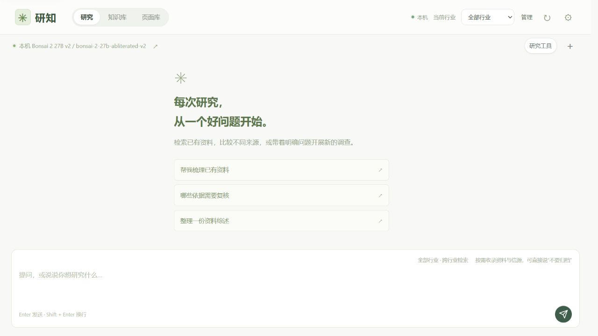
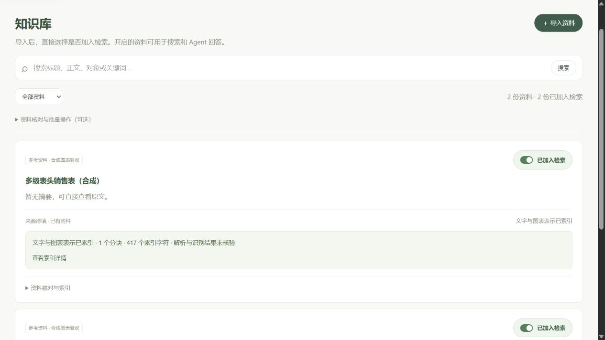
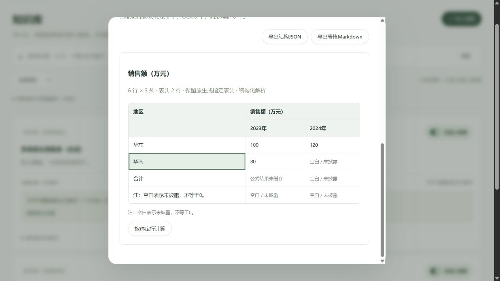
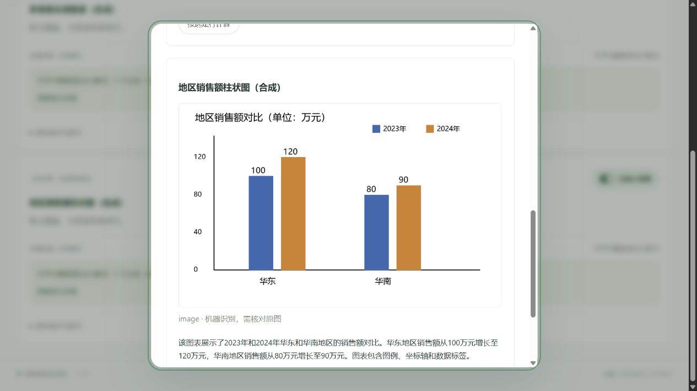

# 研知 · 本地研究知识库

把文档、表格和图片放进自己的资料库，通过搜索与研究助手找到依据，再整理成可追溯的回答和可视化页面。

研知是一个在本机运行的通用知识库。适合个人研究、小型团队文档管理，以及需要保留原件、引用位置和版本历史的资料分析。它不预置行业资料，也不会把“加入检索”当成“事实已核实”。



## 可以做什么

| 功能 | 用法与结果 |
| --- | --- |
| 资料管理 | 导入文档与附件，保存原件、来源、版本、适用范围和历史；按行业或专题隔离管理 |
| 全文搜索 | 本机建立固定分块索引，显示命中片段与位置；加入或退出检索无需先审核 |
| 混合检索 | 可选关键词/BM25与向量召回、RRF融合和专用重排；模型不可用时明确回退 |
| 有依据的问答 | 模型选择支持片段，由后端生成连续引文和真实定位；保留条件、单位、上下限与例外 |
| 表格理解 | 解析多级表头、行标签、单位、合并关系和表注，保留单元格来源；结构化行参与检索 |
| 图片与图表 | 本机OCR与可选本机视觉模型识别图片、扫描PDF、文档嵌入图；保留原图和识别范围 |
| 表格计算 | 选择明确的数据行求和、平均、最小值或最大值，显示输入单元格来源，不把空白当零 |
| 有界网页研究 | 搜索、读取公开原文、批量采集和收录未核验资料，遵守来源范围与访问限制 |
| 可视化页面 | 按需生成流程、结构、对比、表格、统计图和时间轴，支持引用展开、场景修改与草稿恢复 |
| 本地任务与历史 | 图表处理支持暂停、继续、重试；资料版本、可选核验和用户授权的对话历史分别管理 |

公开仓库只包含程序、测试、通用模板和合成演示截图，不包含真实资料、问答原文、索引、模型权重、个人配置或密钥。

## 快速启动

需要 **Python 3.12+**；本次发布在 **Windows / Python 3.14** 上复测。运行应用不需要Node.js，前端回归测试需要Node.js。问答模型和视觉模型不是必装组件：不配置模型也可管理资料、建立全文索引和解析原生表格。

### Windows

```powershell
git clone https://github.com/akuna12315/industry-research-kb.git
cd industry-research-kb
powershell -NoProfile -ExecutionPolicy Bypass -File .\start-web.ps1
```

脚本创建虚拟环境、安装依赖，并从 `config/*.example.json` 初始化本地配置；已有配置不会覆盖。浏览器打开 **http://127.0.0.1:8766/**。服务仅监听本机，首次启动是空白库，没有行业、信源、已配置模型或定时任务。

### 手动启动

```powershell
python -m venv .venv
.\.venv\Scripts\python.exe -m pip install -r web/requirements.txt
.\.venv\Scripts\python.exe scripts/init_workspace.py
.\.venv\Scripts\python.exe -m web.server
```

其他系统可将虚拟环境命令换为 `.venv/bin/python`；跨平台完整验收仍待补充。Windows建议使用较短路径，避免历史文件名触及路径长度限制。已有安装器属于之前的构建，**本轮新增功能请从源码启动**。

## 第一次使用

1. **创建资料范围。** 顶部点击“管理”建立行业或专题；选择后立即保存。切换范围不会自动开启采集；需要跨库搜索时选择“全部行业”。
2. **导入资料。** 进入“知识库 → 导入资料”，上传PDF、DOCX、XLSX、CSV、HTML、TXT/Markdown或图片，单份不超过100MB。新资料默认加入检索，原件保留。
3. **先试本地搜索。** 输入标题、对象或关键词，点击命中结果查看资料及引用位置。关闭“加入检索”会排除搜索和Agent引用，不删除文件。
4. **配置问答模型。** 在“设置 → 模型与助手”填写接口地址、协议、模型ID及所需密钥。支持OpenAI Chat Completions / Responses兼容接口；研究工具还需要相应工具调用能力。本机接口可以使用回环HTTP，厂商接口使用HTTPS。
5. **提问并查看依据。** 例如“根据这份资料，列出不同条件下的限制，并给出引用”；若仅需回答，可明确说“不要保存”“仅回答”或“不添加信源”。没有单个写入范围时，不会猜选行业收录资料。
6. **处理图表。** 资料详情点击“查看 / 处理图表”，设置表头行数和本轮页数，查看结果、单元格来源或导出JSON/Markdown，再向助手提问。
7. **整理展示。** 明确要求“把选中的资料整理成可视化页面”，在页面库查看或调整已保存结果。已保存页面的阅读不需要模型。

### 资料库

检索开关、索引状态和可选质量核对分别显示。行业删除进入可恢复的回收站；恢复不会自动开启采集。



### 表格：理解行列关系

原生DOCX/XLSX表格保留多级表头、横纵合并与来源定位；检索行会携带完整列名、行标签、单位、期间与表注。图片表格采用机器识别重建，复杂合并关系需要人工核对。

空白、数值0和未缓存的Excel公式分开处理。程序不执行工作簿公式、宏或外部链接；计算时拒绝空白、未缓存公式、重复单元格和不同单位，仍需用户确认统计口径适合本次运算。



### 图片：保留原图与识别说明

OCR在本机运行，返回文字、框与识别置信度。可选视觉模型解释图表结构、图例、轴和可见标签；没有明确数据标签时，不按柱高估算精确值。识别结果标为草稿，不能代替核验。



以上四张截图来自同一个**合成演示库**，包括合成销售表和合成柱状图，没有展示真实业务资料。截图中已配置的本机模型是演示环境，首次启动不会预设该模型。

## 可选本机模型

问答、检索和视觉模型分别配置，互不替换，也不会自动回退付费模型。

| 角色 | 配置 | 默认行为 |
| --- | --- | --- |
| 研究与问答 | 页面设置 / `config/agent.json` | 空白，用户自行选择 |
| 向量与专用重排 | `config/retrieval.json` | 关闭，使用本地关键词检索 |
| 图片图形理解 | `config/document-processing.json` | 关闭，仍可解析原生表格和使用本机OCR |

可下载公开检索和视觉权重，脚本核对文件校验值：

```powershell
.\.venv\Scripts\python.exe scripts/setup_retrieval.py
.\.venv\Scripts\python.exe scripts/setup_document_models.py
```

这些命令会访问公开模型仓库并下载权重，**不会自动配置问答模型**。使用本机检索或视觉服务还需提供兼容的 `llama-server`，在对应配置中填写程序/权重路径并启用。配置模板不包含个人路径或密钥，模型权重不随仓库分发。步骤与限制见[图表处理](docs/document-processing.md)和[混合检索](docs/hybrid-retrieval.md)。

## 测试情况

测试结果分为两类，不能互相替代：

- **公开代码回归**使用空白配置、自生成文件与模拟模型，验证功能和权限边界；本次396项后端、33项命令行、9项桌面与104项前端检查全部通过，范围见[测试说明](docs/testing.md)。
- **本机真实模型验收**验证实际模型、检索、解析和回答链路；只公开汇总，不发布真实资料、问答原文或本机配置。

最近一次本机真实验收中，12个问答案例完成，153处显示引文按原文或不可变历史索引独立比对；正式HTTP入口另核对19处引用。合成表格回答正确读出120万元，合成柱状图完整链路读出90万元，选行求和得到180万元；扫描表格PDF的渲染、OCR与表格重建也已通过。这些是有限样例验收，**不是整体问答准确率**。

历史大语料测试使用118,605篇公开中文检索文档：200条固定开发查询的关键词Hit@6为165/200（82.5%）。另6条查询在同一批前16候选中，专用重排的Hit@6由4/6变为6/6，平均Recall@6由0.362714变为0.625534，仍有单题退化。样本很小，不代表完成全库向量化或证明混合检索普遍更优；没有将该语料用于训练问答模型。

复现自动回归：

```powershell
.\.venv\Scripts\python.exe scripts/init_workspace.py
.\.venv\Scripts\python.exe -m unittest discover -s web -t .
.\.venv\Scripts\python.exe -m unittest discover -s scripts -p "test_*.py"
.\.venv\Scripts\python.exe -m unittest discover -s packaging -p "test_desktop.py"
node web/test_frontend.cjs
```

图表测试文件由代码生成，不依赖本机业务附件或下载的训练语料。后端回归不需要真实模型密钥；图片识别质量和真实模型回答另行验收。

## 数据边界与已知限制

- 原件、索引、资料历史和任务保存在本机。使用厂商问答接口时，当前授权的必要片段会发给所选服务；“本机保存”不等于“从不调用网络”。
- 密钥只存在服务内存或用户环境变量，不写入仓库、浏览器存储或明文配置；重启会清空页面输入的内存密钥。
- 资料加入检索、识别完成和可选核验是不同状态；引文定位正确也不能证明每项生成结论都充分受原文支持。
- 图表任务默认每轮最多12个PDF页、4幅图像，可调整并继续下一批；部分完成会保留覆盖范围，不当成全文全部处理完成。
- 低清晰度、复杂多栏、图片合并表和跨页关系仍需复核；没有完成百万级检索性能或整体语义准确率评测。
- 定时采集默认未配置。行业开关只定义外部调度范围，不会自动安装定时任务。

## 项目结构

```text
web/                    页面、API、研究助手、索引与图表处理
scripts/                工作区初始化、命令行、模型准备与评测工具
config/*.example.json   无个人信息的配置模板
templates/              通用资料与更新结果模板
docs/                   用法、测试范围和合成截图
packaging/              Windows构建与源码导出
```

运行后生成的 `config/*.json`、`industries/`、`materials/`、`data/`、`reports/`、`history/`、`work/` 等属于本地数据，不提交到公开仓库。更多用法见[页面指南](web/README.md)。

## 许可

原创代码采用 **GPL-3.0-or-later**，见[LICENSE](LICENSE)与[开源及分发说明](OPEN_SOURCE.md)。第三方依赖、模型和用户导入资料保留各自许可；发布二进制时需提供与该版本对应的可修改源码和构建说明。
